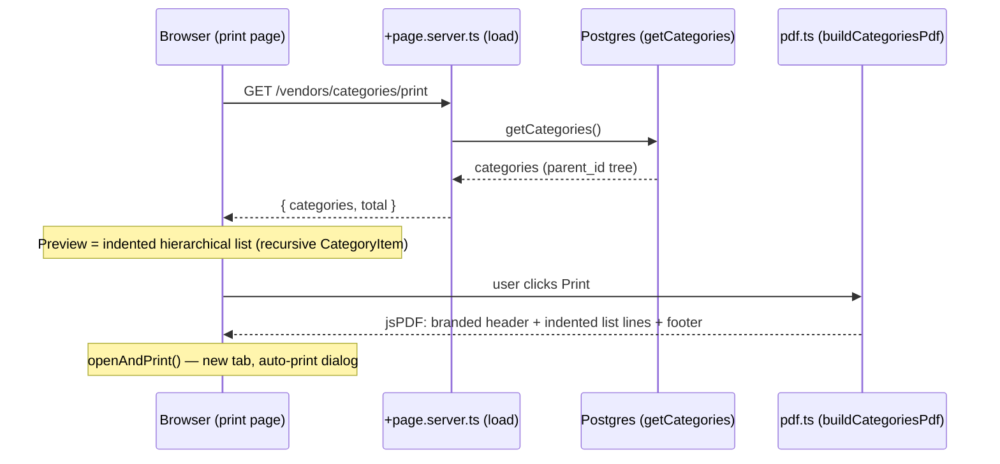

# Categories printable — port to the jsPDF print trigger (list, not table)

**For:** developer implementing the categories print rework; reviewer verifying it.
**Scope:** `src/routes/vendors/categories/print/*` only.
**Goal:** replace the legacy `window.print()` trigger with the jsPDF print pipeline (same as the item list printable) — **while keeping the categories format as an indented hierarchical list, not a table.**

## Background

Two print *pipelines* coexist in this repo (commit `2abc7b4` *"Item list: Used the package jsPDF and auto tables to generate pdf and print"*). What we adopt from it is the **pipeline**, not the **layout**:

| | Item list (inventory) | Categories (today) |
|---|---|---|
| Print trigger | `onPrint → openAndPrint(build…Pdf())` — `src/routes/vendors/inventory/print/+page.svelte:L16` | `window.print()` — `src/lib/components/common/PrintInternalLayout.svelte:L24` |
| PDF builder | `buildInventoryPdf()` (jsPDF + `autoTable`) | none (browser prints HTML) |
| **Content format** | grid table | **recursive indented list** (`CategoryItem.svelte`, `margin-left: level×12px`) |

Adopt: trigger + shared scaffolding (`$lib/utils/pdf.ts`: `createReportDoc`, `addReportFooter`, `openAndPrint`) + `pdf.ts`-per-route structure.
**Do not adopt:** `autoTable`, column styles, the table preview, the foot-row pattern.

## Target flow



## Target design

### Files

| File | Action | Contents |
|---|---|---|
| `src/routes/vendors/categories/print/pdf.ts` | **create** | `buildCategoriesPdf(rows: CategoryRow[], total: number): jsPDF` — indented text lines with manual pagination, **no autoTable** |
| `src/routes/vendors/categories/print/+page.server.ts` | **modify** | return `{ categories, total }` (drop `reportTitle` — the layout already takes it, matching inventory) |
| `src/routes/vendors/categories/print/+page.svelte` | **modify** | switch `PrintInternalLayout` → `PrintReportLayout` with `onPrint={() => openAndPrint(buildCategoriesPdf(rows, total))}`; keep the recursive list preview |
| `src/routes/vendors/categories/print/+layout@.svelte` | keep | already matches the inventory pattern (imports `app.css`) |
| `src/lib/components/pages/vendors/categories/print/CategoryItem.svelte` | **modify** | strip the WIP `-{level}` suffix (`CategoryItem.svelte` now renders `{category.name}-{level}`); keep recursion + `level×12px` indent |

### Data shape

`getCategories()` already returns the full tree (schema `parent_id`; `$lib/utils/categories.ts:L28` `groupedCategories()` nests children). The PDF is rendered from a **flat, depth-annotated, ordered** list:

```ts
export interface CategoryRow {
	id: number;
	name: string;
	depth: number;    // 0 = top level
}
```

- A small pure helper (in `pdf.ts`) walks the **`groupedCategories()` tree in DFS** — parent first, then each child recursively, children remaining in query order (`id DESC`, as `getCategories()` returns them). The same traversal renders the preview, so preview ≡ PDF order by construction. (User decision Q1: keep `id DESC` query order + existing grouping method.)
- `pdf.ts` must stay free of Svelte imports (and of all `$lib` imports except the shared `pdf.ts` helpers) so it is unit-testable from plain Node — the same constraint documented in `$lib/utils/pdf.ts`.

### PDF line format (the actual output)

Built with `doc.text` + manual page breaks, reusing the shared scaffolding:

- Open with `createReportDoc({ title: 'Product Categories' })` (company header, ruled title included).
- One line per category: indent `depth × 14pt` from the left margin, prefix children with `• ` (top level un-prefixed). Font `helvetica` 10pt, comfortable line height (~16pt).
- **Manual pagination**: before writing a line, if `y + lineHeight > pageHeight - 50pt` → `doc.addPage()`, `y = 40`. (Leaves room; the report footer needs the bottom band free — see `addReportFooter` doc note.)
- Long names: wrap with `doc.splitTextToSize(name, pageWidth - margin×2 - indent)` and continue the line indented.
- Empty state: a single centered line `No categories found.` (mirrors the inventory empty-state intent, in list form).
- Optional last content line when categories exist: `Total: N categories` — **included** (user decision Q2).
- Finish with `addReportFooter(doc)`.

### Preview (WYSIWYG)

The preview stays the **recursive indented list** — today's exact format, minus the WIP placeholder:

- `CategoryItem.svelte`: render `{category.name}` (drop `-{level}`), keep `margin-left: level×12px` and recursion.
- 1:1 with the PDF — same order, same hierarchy depth; preview `px` indent (12px) and PDF `pt` indent (14pt) are the same visual step, that match is enough (note the 1px-vs-1pt difference in a code comment).
- No table, no `Item count`, prices excluded (user decision Q3: names + hierarchy only).

## Decisions (user-confirmed)

| # | Question | Decision |
|---|---|---|
| 1 | Order | Keep `getCategories()` `id DESC`; render by DFS of the grouped tree (preview ≡ PDF) |
| 2 | `Total: N categories` line | **Yes** |
| 3 | Item-count suffix | **No** — names + hierarchy only |
| 4 | Subtitle | **No** |

### Hygiene (clean-code phase will enforce)

Existing files in this tree use double quotes / 2-space indentation (`+page.server.ts`, `CategoryItem.svelte`) against the Prettier config (tabs, single quotes — `.prettierrc`). All touched files must pass `npm run lint` as-is when rewritten.

## Acceptance criteria

1. `GET /vendors/categories/print` shows the full category hierarchy as an **indented list** (top level, then children by depth), parent before children.
2. **Print** produces the branded PDF (RAM TECH header box, ruled title `Product Categories`, `Generated on…` + page numbers on every page) with the same indented list and clean page breaks for deep hierarchies — via `openAndPrint`, **no `window.print()` path remains on this route**.
3. **No table anywhere in the new output** (no `autoTable`, no `<table>` in the preview) — the format remains list-based.
4. `npm run check` and `npm run lint` pass on the touched files.
5. Empty state: single centered `No categories found.` line, no error page.
6. `buildCategoriesPdf` + the order/depth helper are callable from plain Node/vitest (no Svelte imports).
7. `CategoryItem.svelte` no longer renders `-{level}` and renders identically to the PDF's order.

## Verification

```
npm run dev
# /vendors/categories/print — preview is an indented list, same order as today
# Print — new tab: branded PDF, indented list, footer on each page, no tables
# deep hierarchy (5+ nesting levels) — page breaks land cleanly
npm run check && npm run lint
```

## Decisions

Locked by the user 2026-07-18 — see the *Decisions* table above; no open questions remain.

## Related

- Pipeline reference (trigger + scaffolding only): `src/routes/vendors/inventory/print/{+page.svelte, +page.server.ts}` and `src/lib/utils/pdf.ts`
- Format reference (today's list): `src/lib/components/pages/vendors/categories/print/CategoryItem.svelte`, `src/lib/utils/categories.ts`
- Data: `src/lib/server/db/queries/categories.ts` (`getCategories`)
- Contract: `PROJECT.md` → Conventions (DB layering, server logic in `+page.server.ts`)
