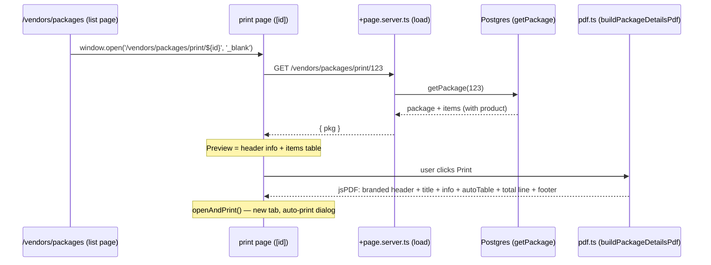

# Package details printable — new print route for a package + its items table

**For:** developer implementing the printable; reviewer verifying it.
**Scope:** new `src/routes/vendors/packages/print/[id]/*` route + one Print entry point in the package view form (`src/lib/components/pages/vendors/packages/package-form.svelte`).
**Goal:** add a printable for package details — the package name and its items in a table — following the established jsPDF print pipeline (same as reports, categories, daily-sales receipt).

## Background (verified in code)

Packages live under **vendors** (`src/routes/vendors/packages/`), backed by:

- `packages` (`id, name, description, total_price, created_at, updated_at`) — `src/lib/server/db/schema.ts:L404`
- `packages_to_products` (`package_id, product_id, serial_number, price, total_price, quantity`) — `schema.ts:L412`
- Query: `getPackage(id)` already returns the package **with items joined to `product`** (`id, sku, sales_description, sale_price`) — `src/lib/server/db/queries/packages.ts`

Two print pipelines exist; we adopt the **jsPDF pipeline** (trigger `onPrint → openAndPrint(build…Pdf())`, preview page renders the same content as HTML):

| Reference | What we take |
|---|---|
| `src/routes/reports/sales-by-customer/print/*` | route shape, `PrintReportLayout` preview, `autoTable` pdf.ts, `openAndPrint` |
| `src/routes/customers/daily-sales/print/[id]/*` | per-`[id]` route param + `error(404, …)` in load |
| `src/lib/utils/pdf.ts` | `createReportDoc`, `addReportFooter`, `ensureSpace`, `formatCurrencyPdf`, `safeNum`, `openAndPrint` |

No package printable exists today.

## Target flow



## Target design

### Files

| File | Action | Contents |
|---|---|---|
| `src/routes/vendors/packages/print/[id]/+page.server.ts` | **create** | parse `+id` from params; invalid → `error(404, …)`; `getPackage(id)`; missing → `error(404, 'Package not found')`; return `{ pkg }` |
| `src/routes/vendors/packages/print/[id]/pdf.ts` | **create** | `buildPackageDetailsPdf(pkg: PackageDetailsData): jsPDF` (interface in this file); `createReportDoc` + branded package header info + `autoTable` items table + total line + `addReportFooter` |
| `src/routes/vendors/packages/print/[id]/+page.svelte` | **create** | `PrintReportLayout` (title `Package — {name}`) with HTML preview: description line (if any), items `<table class="print-table">`, Total line; `onPrint={() => openAndPrint(buildPackageDetailsPdf(pkg))}` |
| `src/routes/vendors/packages/print/[id]/+layout@.svelte` | **create** | copy the pattern from `src/routes/reports/sales-by-customer/print/+layout@.svelte` (imports `app.css`) |
| `src/lib/components/pages/vendors/packages/package-form.svelte` | **modify** | add a **Print** button (Printer icon, `@lucide/svelte`) in the form header/toolbar: `onclick={() => window.open(`/vendors/packages/print/${pkg.id}`, '_blank')}` — visible only when a package is being viewed (`pkg` present) |
| `test/package-details-printable.spec.ts` | **create** | vitest specs for `buildPackageDetailsPdf` (title, header fields, table rows, total, empty-items state, no Svelte imports — plain Node), mirroring `test/daily-sales-receipt-printable.spec.ts` / `sales-by-customer-printable.spec.ts` |

No DB/query changes — `getPackage(id)` already returns everything needed.

### Data shape (pdf.ts)

```ts
export interface PackageItemRow {
	product_id: number;
	quantity: number;
	serial_number: string | null;
	price: string | number;        // rate
	total_price: string | number; // line amount
	product: {
		id: number;
		sku: string | null;
		sales_description: string | null;
		sale_price: string | number;
	} | null;
}

export interface PackageDetailsData {
	id: number;
	name: string;
	description: string | null;
	total_price: string | number | null;
	created_at: string | Date;
	items: PackageItemRow[]; // from packagesToProducts
}
```

`pdf.ts` keeps its constraint: no Svelte or `$lib` imports other than the shared `src/lib/utils/pdf.ts` helpers, so it runs under plain Node/vitest.

### PDF output (the actual printed document)

- `createReportDoc({ title: `Package — ${pkg.name}` })` — branded header + ruled title.
- Info block (plain `doc.text` lines, wrapped with `splitTextToSize` where needed): `Description: …` (only when present), `Created: <date>` (Q4), `Items: N`.
- `autoTable` items table, columns: **# / Description / SKU / Qty / Rate / S/N / Amount** (Q1), widths tuned like the receipt's item table (item column wide, qty/S-N narrower, numeric columns right-aligned). Empty items → single centered `No items in this package.` row.
- Total line below the table: `Total: {formatCurrencyPdf(pkg.total_price)}` — the **stored** `packages.total_price` (user-confirmed Q2), rendered via `safeNum`.
- `addReportFooter(doc)`; page-break safety via `ensureSpace`.

### Preview (WYSIWYG)

HTML in `+page.svelte` mirrors the PDF 1:1 — same columns, same rows, same total; `window.print()` must **not** be used anywhere on this route.

## Decisions (user-confirmed)

| # | Question | Decision |
|---|---|---|
| 1 | Table columns | **# / Description / SKU / Qty / Rate / S/N / Amount** — confirmed |
| 2 | Total line | **Stored `packages.total_price`** (user chose the stored field over the computed sum) |
| 3 | Entry point | **From the view form** (Print button shown when a package is open), not the row dropdown |
| 4 | Info block | **Description + created date + item count** |

## Acceptance criteria

1. `GET /vendors/packages/print/{id}` shows package name, description (if any), items as a table, and Total.
2. Print → branded jsPDF (RAM TECH header, ruled title, items table, total, `Generated on…` + page numbers on every page) via `openAndPrint`; **no `window.print()` path**.
3. Missing package id or unknown id → SvelteKit 404, no 500.
4. Print button in the view form opens the print page in a new tab; list page itself unchanged.
5. `npm run check` and `npm run lint` pass on touched files (tabs, single quotes per Prettier config).
6. `buildPackageDetailsPdf` callable from plain Node; vitest specs in `test/package-details-printable.spec.ts` pass.

## Verification

```
npm run dev
# /vendors/packages → row … (dropdown) → View → form → Print → new tab
#   preview: name, description, items table, Total
#   Print → new tab: branded PDF, clean table, footer on each page
# unknown id (…/print/999999) → 404 page
npm test && npm run check && npm run lint
```

## Pipeline

```
clean-code (route + entry point + pdf.ts) → tester (specs + suite) → code-review → report
```

## Related

- Pipeline refs: `src/routes/reports/sales-by-customer/print/{+page.svelte, pdf.ts}`, `src/routes/customers/daily-sales/print/[id]/*`
- Shared scaffolding: `src/lib/utils/pdf.ts`, `src/lib/components/common/PrintReportLayout.svelte`
- Data: `src/lib/server/db/queries/packages.ts` (`getPackage`), `src/lib/server/db/schema.ts` (`packages`, `packages_to_products`)
- Precedent spec: `ai-docs/categories-printable-spec.md`
- Contract: `PROJECT.md` → Conventions (DB layering, `error(404, …)`, server logic in `+page.server.ts`)
