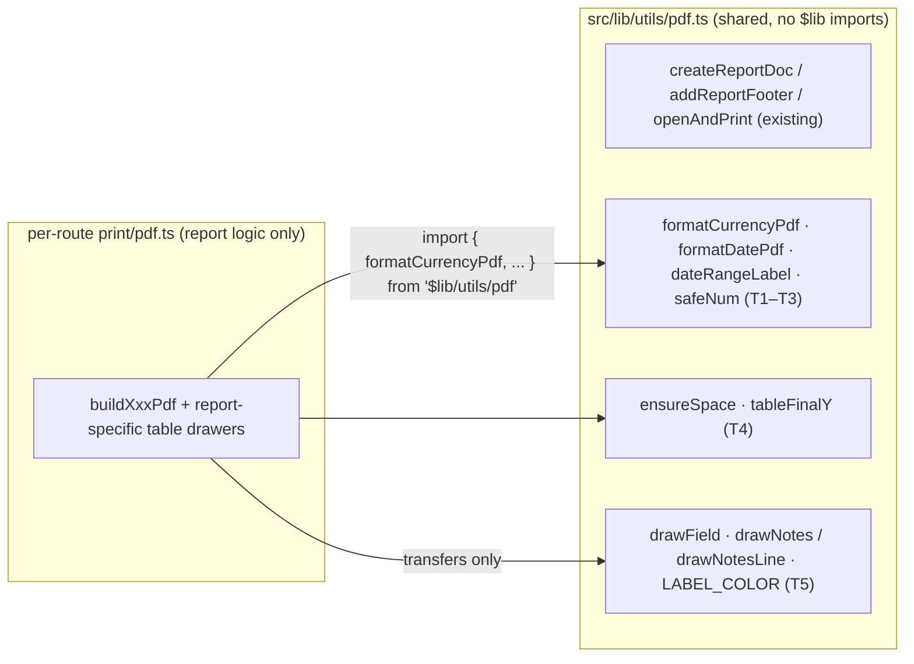

# PDF shared-helpers consolidation — spec & tasks

**For:** the developer (or agent) picking up the PDF helper cleanup next.
**Scope:** deduplicate the utility helpers currently copy-pasted across the 11 printable-route `pdf.ts` files into the existing shared module `src/lib/utils/pdf.ts`, and record the exact behavior decisions that require a human call.

## Overview

Every printable route ships its own `pdf.ts` that builds a jsPDF document. The scaffolding (company header, footer, auto-print) is already shared via `createReportDoc` / `addReportFooter` / `openAndPrint` in `src/lib/utils/pdf.ts` — all 11 files import from it (e.g. `src/routes/vendors/inventory/print/pdf.ts:L2`). But the small formatting/pagination helpers below were copy-pasted per route, and some copies have **drifted apart** (different signatures, one pair with genuinely different outputs). We consolidate the truly shared helpers into `src/lib/utils/pdf.ts` and delete the local copies. The report-specific table drawers stay put — they are domain code, not utilities.

## Evidence — what is duplicated

| Helper | Copies in | Status |
|---|---|---|
| `formatCurrencyPdf` | 10 `print/pdf.ts` files (see list below) | Body identical except input-type variance; `profit-loss` wraps the same logic in `toAmount`+`formatAmount` |
| `formatDate` / `formatDatePdf` | 5 `print/pdf.ts` files + `purchases-by-vendor/print/+page.svelte` | **Drift:** reports use locale `'default'`, transfers use `'en-US'` |
| `safeNum` | `open-sales-by-customer`, `sales-by-customer` (`profit-loss`'s `toAmount` is the same function renamed) | Identical |
| `dateRangeLabel` | `open-sales-by-customer`, `profit-loss`, `purchases-by-vendor`, `sales-by-customer` | Identical verbatim, including the `—` separator |
| `tableFinalY` | the same 4 report files | Identical (jspdf-autotable `lastAutoTable.finalY` accessor) |
| `ensureSpace` | the same 4 report files + all 4 transfer files | Identical verbatim (48pt footer band, addPage → 48) |
| `drawField` | all 4 transfer files (ibrrs, rmas, strs, fix-assets) | Identical verbatim (incl. `LABEL_COLOR` constant) |
| `drawNotes` / `drawNotesLine` | all 4 transfer files | Identical verbatim |
| `titleCase` | `daily-sales` (`print/[id]/pdf.ts`), `sales-by-customer` | **Drift: different outputs** — see Decision D2 |
| `capitalize` (transfers) vs `capitalizeFirstLetter` (`src/lib/utils/common.ts`) | 1 + 1 | Same one-liner, two names |
| `viewTitle` | the 4 report files | Same shape, different labels — see Decision D5 |

Files in scope (11): `customers/daily-sales/print/[id]/pdf.ts`, `reports/{open-sales-by-customer,profit-loss,purchases-by-vendor,sales-by-customer}/print/pdf.ts`, `vendors/{categories,inventory}/print/pdf.ts`, `vendors/transfers/{fix-assets,ibrrs,rmas,strs}/print/[id]/pdf.ts` (plus one `+page.svelte` occurrence for optional task T3c).

## Target design



*Caption: after the change, every `print/pdf.ts` keeps only its `buildXxxPdf` flow and table drawers; all cross-report utilities come from `$lib/utils/pdf`.*

### Canonical API added to `src/lib/utils/pdf.ts`

```ts
export const PDF_LABEL_COLOR: [number, number, number] = [102, 102, 102];

export function formatCurrencyPdf(value: string | number | null | undefined): string
export function formatDatePdf(value: Date | string | number | null | undefined): string
export function dateRangeLabel(filters?: { from?: string | null; to?: string | null }): string
export function safeNum(value: unknown): number
export function tableFinalY(doc: jsPDF, fallback: number): number
export function ensureSpace(doc: jsPDF, y: number, needed: number, pageHeight: number): number
export function drawField(doc: jsPDF, x: number, width: number, label: string, value: string, y: number): number
export function drawNotes(doc: jsPDF, notes: string, margin: number, y: number, pageWidth: number, pageHeight: number): number
export function drawNotesLine(doc: jsPDF, line: string, margin: number, y: number, pageHeight: number): number
export function titleCase(value: string): string
export function capitalizeFirst(value: string): string
```

Rules:
- Names are the **new** canonical names above; call sites import them. Local copy-paste names (`formatDatePdf` in transfers, `capitalize`, `toAmount`) disappear.
- Keep the file free of `$lib` imports (its existing doc comment, `src/lib/utils/pdf.ts:L4-6`, requires this so it can run from plain Node scripts). `capitalizeFirst` therefore lives here instead of re-exporting `common.ts`.
- `drawNotesLine` is exported (currently private) only because `drawNotes` calls it — call sites never use it directly.
- Formatting bodies: adopt the most-permissive-argument variant that already exists (e.g. the `null | undefined`-tolerant `formatCurrencyPdf` from `customers/daily-sales/print/[id]/pdf.ts`) so every current call site type-checks without changes.

## Decisions required before implementation

- **D1 — Date locale (behavior change).** Reports format with `toLocaleDateString('default', …)` (`reports/profit-loss/print/pdf.ts`), transfers with `'en-US'` (`vendors/transfers/rmas/print/[id]/pdf.ts`). Picking one is a visible change to the other group's PDFs. **Proposal: `'en-US'`** (deterministic across deployment environments; `'default'` follows server/browser locale and can silently differ). Ratify or override.
- **D2 — `titleCase` semantics (behavior change, latent bug risk).** `daily-sales` capitalizes each whitespace-separated word *preserving interior case*; `sales-by-customer` lowercases first (`text.toLowerCase().replace(/\b\w/g, …)`), which mangles mixed-case inputs (e.g. `"RMA 123"` → `"Rma 123"`… actually `"RMA 123"` → `"RMA 123"` but `"rma 123"` → `"Rma 123"`). **Proposal: adopt the preserve-interior-case version** (`value.split(' ').map(w => w.charAt(0).toUpperCase() + w.slice(1)).join(' ')`) — it can only look the same-or-better to every realistic input. Note the real divergence case: an input like `"salesOrder"` renders `"Salesorder"` under the proposed version and `"SalesOrder"` is what a human probably wanted — if a call site relies on that, flag it in review.
- **D3 — `viewTitle`.** Same shape, different labels and different view token (`'detailed'` vs `'detail'`). **Proposal: do NOT hoist** — parameterizing would give a helper with 3 string args used by 4 call sites, buying <10 lines. Leave per-report. (Cheap win if user disagrees: `export function viewTitle(view: string, base: string, detailLabel: string): string`.)
- **D4 — Svelte-side `formatDate` in `purchases-by-vendor/print/+page.svelte`.** Optional T3c; importing `$lib/utils/pdf` into the browser bundle is legal (it only imports `jspdf`) but couples a preview to PDF utilities. **Proposal: do** — it's the same function, and one less fork to drift.
- **D5 — `grandTotalOf`, `pageWidthOf`, `groupDetailByVendor`, `expandStrItems`, all `draw*Table`/`draw*` report drawers.** Out of scope — domain-specific, no second copy. (`pageWidthOf` is a two-line `doc.internal.pageSize.getWidth()`; fine inline.)

## Tasks

Each task ends with the same gate: `npm run check` && `npm run lint` clean; no PDF-output change expected (except D1/D2 deltas).

- **T1 — Money + numbers into shared.** Add `formatCurrencyPdf`, `safeNum` to `src/lib/utils/pdf.ts`; delete the 10 + 2 local copies; update imports. Remove profit-loss's `toAmount`/`formatAmount` wrappers in favor of `formatCurrencyPdf` (identical output).
  Files: all 11 `print/pdf.ts`, `src/lib/utils/pdf.ts`.
- **T2 — Dates.** Add `formatDatePdf` (per D1) + `dateRangeLabel` to shared; delete 5 `formatDate`/`formatDatePdf` copies and 4 `dateRangeLabel` copies; update imports.
  Files: `open-sales-by-customer`, `profit-loss`, `purchases-by-vendor`, `sales-by-customer`, `daily-sales` (if present), all 4 transfers, `src/lib/utils/pdf.ts`.
- **T3 — Client-side date copies (T3a: transfers done in T2; T3b: `daily-sales` if any; T3c (opt., per D4): `purchases-by-vendor/print/+page.svelte` `formatDate` → import shared).**
- **T4 — Pagination helpers.** Add `ensureSpace`, `tableFinalY` to shared; delete the 6 + 3 local copies; update imports. (Keep the 48pt footer-band constant in one place — extract `export const PDF_FOOTER_BAND = 48;` and use it in `ensureSpace`.)
- **T5 — Transfer form-field helpers.** Add `drawField`, `drawNotes`, `drawNotesLine`, `PDF_LABEL_COLOR` to shared; delete the 4×4 copies (incl. each file's `LABEL_COLOR` and `capitalize`); point transfer `drawField`'s label color at `PDF_LABEL_COLOR`.
  Files: `vendors/transfers/{ibrrs,rmas,strs,fix-assets}/print/[id]/pdf.ts`.
- **T6 — String helpers.** Add `titleCase` (per D2) and `capitalizeFirst` to shared; replace `titleCase` in `daily-sales` + `sales-by-customer`, `capitalize` in `fix-assets`.
- **T7 — Sweep + verify.** `grep -rn "function formatCurrencyPdf\|function ensureSpace\|function drawField\|function dateRangeLabel\|function tableFinalY\|function safeNum\|function formatDate" src/routes` must return **zero** hits outside `src/lib/utils/pdf.ts`. Then: `npm run check`, `npm run lint`, `npm test`; smoke-generate one report PDF and one transfer PDF (e.g. via the existing `.tmp-pdf-test` flow or the print pages) and diff-check header/totals render as before.
- **T8 — Review gate.** code-review on the full diff; expected to see zero behavioral changes beyond the ratified D1/D2 deltas.

## Risks / pitfalls

- These are server-routed, jsPDF-generated documents — **no unit test currently pins the rendered output**, so "same before / after" rests on T7's visual smoke check. Consider adding one: export a sample build (e.g. `buildCategoriesPdf` — it's the smallest, `vendors/categories/print/pdf.ts`, 91 lines) and snapshot the text layer. (Suggestion only — out of scope for this spec.)
- `profit-loss/print/pdf.ts` currently **exports** `formatCurrencyPdf` (the only one of the 10). Confirm nothing imports it before deleting the local copy (T1 verification).
- Locale/locale-locale: `toLocaleDateString('default')` in Node (server route) resolves with the server's ICU — D1 removes that instability.

## Related

- `ai-docs/*-printable-spec.md` — the per-report spec this consolidation preserves
- `ai-docs/print-migration-tasks.md` — prior print-migration task list
- `src/lib/utils/pdf.ts` — the shared module being extended
- `src/lib/utils/common.ts` — existing string utils (note the `capitalizeFirstLetter` twin)
