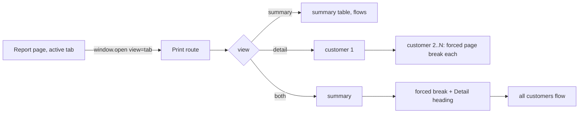

# Sales by Customer print — one page per customer: finding

For developers deciding whether (and where) to change the detail-view pagination of the Sales by Customer print. **The fix has since been implemented** (flowing customers in the detail view) — the sections below record the original investigation; the implementation notes at the bottom record what changed.

**Bottom line:** the one-page-per-customer behavior is not a bug in the PDF port — it is an intentional, spec'd behavior of the `detail` view, applied identically in the HTML preview (`page-break-before: always`) and the jsPDF output (`doc.addPage()`). It only triggers when you print with the **Detail** tab active; `summary` and `both` are unaffected.

## Where the behavior lives

| Output | File | Mechanism |
|---|---|---|
| HTML preview | `src/routes/reports/sales-by-customer/print/+page.svelte:100` | `class:page-break={cIdx > 0 && view === 'detail'}` on each customer `<h3>` |
| Page-break CSS | `src/lib/components/common/PrintReportLayout.svelte:256-257` | `:global(.page-break) { page-break-before: always; }` |
| jsPDF | `src/routes/reports/sales-by-customer/print/pdf.ts:157-160` | `if (cIdx > 0 && view === 'detail') { doc.addPage(); cursor = 48; }` inside `drawDetailSections` |

`page-break-before: always` fires **even when the current page has room left**, and the jsPDF branch unconditionally starts a fresh page. So every customer after the first begins top-of-page — with typically just their header, one or a few orders, and their subtotal — which is exactly the "one page per customer" symptom reported.

## Behavior by view

`view` comes from the URL (`src/routes/reports/sales-by-customer/print/+page.server.ts:6`, default `summary`); the report page opens print with `view=` set to the active tab (`src/routes/reports/sales-by-customer/+page.svelte:61`, tab default `summary` at line 30).

| View | What prints | Page breaks |
|---|---|---|
| `summary` | One customer-level table + Grand Total | None per customer |
| `detail` | Per customer: heading, SO blocks + item tables, Subtotal | **Forced new page before every customer after the first** |
| `both` | Summary, forced page break, `Detail` heading, then detail sections | One forced break after summary (`.page-break` div); detail sections **flow continuously** |

*The detail branch is the only one that page-breaks per customer — that is the branch to touch if the behavior should change.*

## Why it is built this way

The spec for this printable explicitly records the decision:

- `ai-docs/sales-by-customer-printable-spec.md:13` — *"Page breaks before each new customer when `view === 'detail'`."*
- `ai-docs/sales-by-customer-printable-spec.md:67` — Decision 2: *"Section page-breaks in `both` view … today's CSS only forces a page break per customer in `detail` view — PDF mirrors that exactly (no forced break in `both`)."*

The PDF code carries the same intent in a comment at `pdf.ts:156-157`. So the two output paths agree; neither is out of sync.

## Verified scope

- **Affected:** only Sales by Customer printing with `view=detail` (both the browser print preview and the "print via jsPDF" path).
- **Not affected:** `summary`, `both` (its detail sections flow), and the sibling `open-sales-by-customer` report — no per-customer page-break pattern found in its print files.

## If the desired behavior is flowing customers — implemented

The client confirmed they want flowing customers. Applied (§ suggestions below, all done):

1. `+page.svelte` — removed the `class:page-break` binding from the customer `<h3>` (customers now page-break only on physical overflow).
2. `pdf.ts` — removed the `cIdx > 0 && view === 'detail'` `addPage()` branch in `drawDetailSections`; the unused `view` parameter and `cIdx` were dropped with it (the existing `ensureSpace` calls still break a page when a customer block doesn't fit).
3. `ai-docs/sales-by-customer-printable-spec.md` — decision 3 records the change; the detail-view background line updated.
4. `test/sales-by-customer-printable.spec.ts` — the old “page breaks before every customer” assertion was replaced by flowing-layout tests (2-customer detail fits one page; 30 customers paginate below 30 pages and stay in order).

## Related

- `ai-docs/sales-by-customer-printable-spec.md` — the spec being mirrored
- `ai-docs/pdf-shared-helpers-spec.md` — `ensureSpace` / `tableFinalY` helpers used by the PDF path
- `src/lib/utils/pdf.ts` — shared jsPDF helpers
- `src/routes/reports/sales-by-customer/print/+page.server.ts` — view/filters loading
